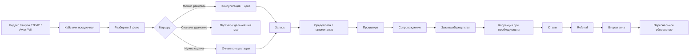
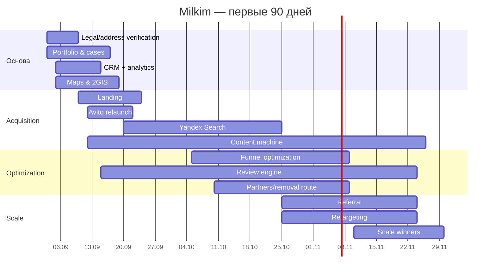
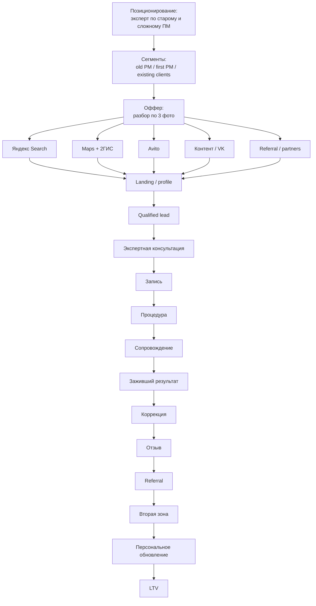

# Milkim: глубокое исследование рынка и маркетинговая стратегия для Омска

## Executive Summary

Исследование выполнено на **2 сентября 2026 года**. Исходная задача — превратить Milkim из мастера с отдельными локальными источниками клиентов в Омске и существующей базой в Русской Поляне в локальный бренд с системным привлечением, сильной специализацией, измеримой воронкой, повторными продажами и рекомендациями. Ключевая исходная гипотеза — использовать как центральную компетенцию **исправление и перекрытие старого перманентного макияжа**, не отказываясь от обычного перманента губ, бровей и межресничной зоны. fileciteturn0file0

### Главный вывод

**Гипотеза подтверждается, но позиционирование нужно сформулировать шире, чем «мастер по перекрытию».**

Рекомендованная модель:

> **Milkim — эксперт по сложному и старому перманенту: честно определяем, что можно аккуратно обновить или перекрыть, а что сначала нужно осветлить/удалить; плюс делаем естественный новый перманент губ, бровей и межреснички.**

Почему именно так:

Во-первых, проблема старого пигмента реальна. В исследовании женщин, обращавшихся за удалением неудовлетворительного перманента бровей, цвет был одной из наиболее частых причин недовольства; сочетание проблем цвета и формы также встречалось очень часто. Профессиональные публикации отдельно указывают, что при смене формы или стиля иногда сначала требуется удаление/осветление старого пигмента. citeturn8search14turn8search8

Во-вторых, та же боль видна прямо в Омске. В локальном отзыве клиент описывает старый татуаж, который «**ушёл в синий цвет**», после чего его удалили и сделали новый результат; у других омских мастеров в отзывах регулярно встречаются истории исправления прежней работы, удаления старых слоёв и страха повторить неудачный опыт. citeturn20view5turn19view9turn19view10

В-третьих, **«натуральный перманент» сам по себе слабое позиционирование**: естественность, аккуратность, индивидуальная форма, стерильность и комфорт уже являются стандартными обещаниями сильных омских конкурентов. Например, эти аргументы прямо используют студии Василины Евтушенко и «Сфера Перманента», а клиентские отзывы у ряда студий постоянно хвалят естественный результат. citeturn19view7turn13view3turn20view5

В-четвёртых, специализация на старом перманенте не означает обещание «перекроем всё». Это как раз должно стать **антиоффером и механизмом доверия**:

> **«Старый перманент можно перекрыть не всегда. Пришлите 3 фото — честно скажем, что разумнее в вашем случае: обновить, перекрыть, сначала осветлить/удалить или вообще не трогать сейчас».**

Такое обещание одновременно продаёт компетентность и снижает риск завышенных ожиданий. Удаление перманентного пигмента может быть сложным и непредсказуемым; лазерное воздействие на некоторые пигменты способно вызвать нежелательные изменения цвета, а полное удаление не гарантируется. citeturn8search13turn7search0

### Ответы на ключевые вопросы

| Вопрос | Решение |
|---|---|
| **Где Milkim может выиграть рынок Омска?** | Не в общем обещании «красивого натурального ПМ», а в **разборе и исправлении старых работ**, подкреплённом большим портфелем кейсов «до → путь решения → заживший результат». |
| **Какое позиционирование выбрать?** | «Эксперт по сложному и старому перманенту + естественный новый ПМ». Не «исправим всё», а «честно определим правильный путь». |
| **Делать ли перекрытие главным направлением?** | **Да — как главный маркетинговый крючок и вход в бренд**, но не как единственную услугу. |
| **Самые перспективные клиенты?** | Женщины со старым/изменившим цвет/неудачным ПМ; затем клиенты, впервые делающие ПМ и максимально боящиеся плохого результата; затем текущие клиенты на вторую зону и обновление. |
| **Первый оффер?** | **Бесплатный разбор старого перманента по 3 фото** с ответом «перекрытие / сначала осветление-удаление / нужна очная оценка». |
| **Какие каналы запускать первыми?** | Яндекс Карты + 2ГИС, Яндекс Поиск/Директ, текущий Авито, системный контент VK/доступные площадки, CRM + отзывы/referral. |
| **Нужен ли сайт?** | **Да, но не большой сайт.** Нужен один сильный лендинг под исправление/перекрытие и рекламный трафик. |
| **Нужно ли приложение?** | **Нет. Отдельное приложение сейчас нерационально.** CRM + онлайн-запись + при необходимости Telegram-бот для фото и сопровождения решат почти все задачи дешевле. |
| **Как строить повторные продажи?** | Коррекция → контроль зажившего результата → отзыв → вторая зона → referral → индивидуальное напоминание об обновлении. |
| **Что делать ближайшие 90 дней?** | Сначала упаковка позиции, кейсов, карт, CRM и лендинга; затем запуск Search/Avito; затем оптимизация CAC, партнёрства, referral и масштабирование победивших связок. |

### Как я бы сформулировал бренд Milkim уже сейчас

Основная версия:

> **Milkim — перманентный макияж и исправление старого перманента в Омске.**

Подзаголовок:

> **Старый цвет, форма или чужая работа? Сначала разберём ваш случай по фото. Если перекрывать сейчас нельзя — честно скажем об этом.**

CTA:

> **Отправить 3 фото старого перманента**

Вторичная коммуникация:

> **Естественные брови, губы и межресничка — без ощущения «нарисованного лица».**

Это важное сочетание: **«исправление» захватывает болезненный спрос, а «естественный новый ПМ» не сужает рынок до клиентов с проблемами.**

## Рынок, спрос и правовые рамки

### Что происходит с категорией

Надёжного общероссийского публичного отчёта, позволяющего корректно назвать объём рынка перманентного макияжа в рублях именно на 2026 год, в ходе исследования не найдено. Поэтому цифры «рынок ПМ в России составляет N миллиардов» я сознательно не использую.

Для Milkim важнее другое: **локальный рынок Омска уже зрелый и конкурентный**. В одной только публичной выборке есть специализированные мастера и студии с десятками, сотнями и в отдельных случаях более чем 300 пользовательскими оценками: у Василины Евтушенко в 2ГИС отображалось 363 оценки, у MK PM Studio — порядка 350, у Olesya Ozi — более 300, у Top Permanent — более 200. Это означает, что потребителю есть из чего выбирать и «просто хорошего мастера» недостаточно. citeturn19view7turn2search5turn1search7turn14search0

Публичные предложения сильных игроков повторяют один и тот же набор ценностей:

**естественность → индивидуальная форма → аккуратность → комфорт/минимум боли → стерильность → опыт/награды → скидка на первый визит.**

Василина Евтушенко одновременно подчёркивает 15 лет опыта, натуральность результата и скидку 10% на первое посещение; «Сфера Перманента» акцентирует натуральные техники, индивидуальный эскиз и стерильность; Olesya Ozi использует чемпионский статус и качество/стерильность как ключевой аргумент. citeturn19view7turn13view3turn0search3

**Вывод:** конкурировать слоганом «натуральный перманент от профессионального мастера» бессмысленно. Это уже гигиенический минимум категории.

### Что на самом деле покупает клиент

По локальным отзывам можно выделить пять устойчивых работ, которые клиент «нанимает» перманент выполнять.

**Убрать ежедневную рутину.** В омских отзывах женщины прямо связывают ПМ с экономией времени утром и отсутствием необходимости постоянно красить губы или брови. citeturn20view5turn11search22turn19view7

**Получить естественный результат, а не «татуировку на лице».** Клиенты хвалят натуральную форму и оттенок и одновременно описывают страх перед искусственными бровями или неестественными губами. citeturn2search16turn20view5turn14search18

**Снизить риск ошибки на лице.** Решение часто откладывается из-за страха боли и результата; затем решающими доказательствами становятся работы мастера, отзывы, рекомендации и объяснение процесса. citeturn20view5turn19view10turn19view9

**Исправить то, что уже есть.** Старый цвет, неудовлетворительная форма, накопленные слои и результаты другого мастера формируют отдельную высокоболевую категорию. Это подтверждается как научными данными, так и локальными омскими отзывами. citeturn8search14turn20view5turn19view9

**Найти «своего» мастера надолго.** В локальных отзывах видно повторное посещение спустя годы, переход брови → губы → межресничка и приведение родственниц/подруг. citeturn20view5turn11search12turn10search20

### Поисковый спрос: что мы знаем, а что пока нет

Яндекс Вордстат официально позволяет смотреть частотность запросов, динамику, города и регионы, но интерфейс доступен авторизованным пользователям; через открытую веб-индексацию получить надёжные текущие абсолютные частоты именно по Омску нельзя. Поэтому в этом отчёте я **не выдаю искусственно точные цифры запросов в месяц**. citeturn16search2turn16search6

Перед запуском Директа нужно одним экспортом Вордстата получить фактические частоты по Омску для кластеров:

| Кластер | Семантика для проверки |
|---|---|
| Общий | перманентный макияж омск; студия перманентного макияжа омск; мастер перманента омск |
| Брови | перманент бровей омск; пудровые брови омск; волосковый перманент омск |
| Губы | перманент губ омск; акварельные губы омск |
| Глаза | межресничка омск; перманент межресничного пространства омск |
| Проблемный PM | исправление перманента омск; перекрытие старого татуажа омск; перекрытие перманента бровей омск |
| Удаление | удаление перманента омск; удалить татуаж бровей омск |
| Цвет | синие брови после татуажа; серые брови перманент; красные брови после перманента |
| Вопросы | можно ли перекрыть старый татуаж; нужно ли удалять старый перманент перед новым |

Именно Wordstat позволяет затем отделить реальные пользовательские формулировки от наших маркетинговых гипотез и сравнить интерес по регионам. citeturn16search3turn16search13

### Почему карты должны стать одним из первых каналов

Яндекс Бизнес бесплатно выводит заполненную организацию в Поиск и Карты и позволяет добавить услуги и фотографии. В платном продвижении доступны более заметное размещение, витрина, акция, кнопка записи и показы рядом с похожими организациями; сам Яндекс указывает, что на позицию влияют в том числе релевантность, расстояние, рейтинг, качество профиля и бюджет. citeturn15search0turn15search1turn15search3

Для Milkim это критично, потому что сильные локальные конкуренты уже активно используют карточки с кнопками записи, прайсами, сотнями фотографий и большим количеством отзывов. Например, профиль Василины Евтушенко содержит кнопку записи, 246 фотографий и более 300 отзывов/оценок. citeturn19view7

2ГИС также позволяет публиковать цены для beauty-компаний, отзывы и фотографии, а рекламодателям — использовать дополнительные витринные возможности и микросайт. citeturn17search0turn17search10

Отсюда первый важный принцип:

> **Карточка Milkim в Яндекс Картах и 2ГИС — это не справочник с адресом. Это полноценная локальная посадочная страница.**

Публичный Flamp на момент индексирования показывал Milkim как студию перманентного макияжа по адресу **Дмитриева, 5/1, кабинет 12**, без опубликованных отзывов Flamp. Поскольку владелец не подтвердил этот адрес в исходных данных, его нужно считать **публично найденной, но требующей проверки информацией**, а не окончательным фактом проекта. citeturn14search14

Если карточка действительно текущая, отсутствие отзывов особенно критично на фоне конкурентов с десятками и сотнями оценок. citeturn14search14turn19view7turn14search0

### Правовые ограничения, которые непосредственно меняют маркетинг

С **1 сентября 2025 года** в России действует запрет на распространение рекламы на интернет-ресурсах организаций, деятельность которых признана нежелательной/экстремистской/террористической, а также на ресурсах, доступ к которым ограничен российским законодательством. Основание — Федеральный закон №72-ФЗ от 7 апреля 2025 года. citeturn21search0turn21search2

ФАС отдельно разъяснила, что нарушением после 1 сентября 2025 года может считаться не только новая публикация, но и действия по повторному распространению старой рекламы; при этом вопрос о том, является ли конкретный контент рекламой, оценивается индивидуально. citeturn19view1

**Практический вывод для Milkim:** Instagram/Facebook нельзя строить как оплачиваемый рекламный канал или канал рекламных интеграций для российского рынка. Органический архив/портфолио и рекламное размещение — разные юридические вопросы; перед системным использованием спорных площадок стоит оценивать конкретный формат публикаций, а не исходить из старой практики 2023–2024 годов. citeturn21search2turn19view1

Для разрешённой интернет-рекламы в России также действуют требования к идентификатору интернет-рекламы и учёту рекламных данных; актуальные требования к идентификатору были утверждены приказом Роскомнадзора №68 от 25 марта 2025 года. citeturn21search17

На стороне самой услуги Роспотребнадзор в актуальном материале от сентября 2025 года прямо указывает на санитарные требования СП 2.1.3678-20, необходимость стерильных материалов и инструментов для манипуляций, повреждающих кожу, и относит такие процессы, включая татуирование, к области, где возникает вопрос обязательного лицензирования. citeturn19view2

**До масштабирования рекламы Milkim необходимо отдельно проверить фактическую организационно-правовую и лицензионную модель конкретного кабинета в Омске.** Это нельзя решать маркетинговым предположением: требования зависят от того, какие именно процедуры оказываются, кем и в каком помещении. citeturn19view2

## Конкурентная карта Омска и цены

### Длинный список рынка

Ниже — публично найденная выборка из **30 омских игроков**, встречавшихся в 2ГИС, Flamp, собственных сайтах и связанных публичных источниках. Это не означает, что каждый из них одинаково активен именно сегодня: часть карточек была проиндексирована поиском несколько месяцев назад, поэтому перед непосредственной рекламной атакой статусы и прайсы нужно перепроверить live. Я сознательно не заполняю неизвестные поля догадками.

| Конкурент | Локация / публичный сигнал | Масштаб публичного доверия | Старый ПМ / удаление | Основные публичные активы |
|---|---|---|---|---|
| Olesya Ozi | 70 лет Октября, 15; несколько филиалов | ~300+ отзывов/оценок | Не центральный оффер | 2ГИС, сайт/соцсети, запись, TG/WA, видео citeturn0search3turn1search7 |
| Василина Евтушенко | Комарова, 14 | 363 оценки, 318 отзывов на просмотренной карточке | Есть удаление татуажа | 2ГИС, сайты, запись, 246 фото citeturn19view7 |
| THE MIRA | Маяковского, 9 | ~230 оценок | В отзывах есть путь «сначала удаление → коррекция цвета» | 2ГИС, активные акции citeturn0search5turn1search21 |
| Наталья Метцлер | 70 лет Октября, 26 | ~100 оценок | н/д | сайт, 2ГИС, VK, программа лояльности/UDS citeturn10search17turn11search8 |
| Центр Ольги Климовой | Комарова, 21 к2 | ~60 оценок | **Сильный массив отзывов про удаление старого ПМ** | сайт, 2ГИС, VK/TG/WA citeturn10search11turn19view9 |
| Sima_beauty | Фрунзе, 80 | ~60 оценок | н/д | 2ГИС, VK, онлайн-запись citeturn1search3 |
| Сфера Перманента | Карла Маркса, 20 | ~15 оценок | remover, исправление бровей | сайт, 2ГИС, VK/TG/WA citeturn13view1turn13view3 |
| Top Permanent | Ватутина, 9 | ~200 оценок | н/д в основном оффере | сайт, 2ГИС, VK/TG/WA citeturn14search0turn14search10 |
| MK PM Studio | Комарова, 15 к2 | ~350 оценок | удаление старого перманента | 2ГИС, обучение/ПМ citeturn2search5 |
| Арна Утарова | Транссибирская, 6 к1 | ~75 оценок | в отзывах встречаются прошлые неудачные работы | 2ГИС, студия татуажа/ПМ citeturn19view10 |
| Vesna | 2-я Линия, 61 | ~100 оценок | н/д | 2ГИС, комплекс beauty-услуг citeturn11search22 |
| M.pm | Лермонтова, 79 | 26 оценок | есть кейсы «переделанных бровей» | 2ГИС citeturn11search12 |
| Студия ПМ, Игоря Мишина | Игоря Мишина, 2 | 32 оценки | **удаление + перекрытие синего старого татуажа** | 2ГИС, фото/отзывы citeturn20view5 |
| Penkova Brows | Карла Маркса, 20 | ~80 оценок | удаление ПМ/тату | 2ГИС citeturn2search22 |
| Есения Дёмина | Мира, 33а | ~30 оценок | н/д | 2ГИС, VK/TG/WA citeturn10search18 |
| Наталья Меньшикова | Перелёта, 28 | ~58 оценок | н/д | 2ГИС, VK/TG/WA citeturn10search13 |
| Margo Brows | Декабристов, 45 | ~13 оценок | н/д | 2ГИС, VK/TG/WA, запись citeturn1search9 |
| Algaza.pm | Фрунзе, 52 | публичная карточка | н/д | 2ГИС, запись, WA/TG citeturn1search2 |
| Кабинет ПМ/косметологии | Туполева, 8 к2 | публичная карточка | н/д | 2ГИС citeturn2search0 |
| Студия ПМ на Заозёрной | Заозёрная, 25 к4 | небольшая карточка | н/д | 2ГИС, TG citeturn10search5 |
| Студия ПМ на Комарова | Комарова, 17 к3 | публичная карточка | указано удаление | 2ГИС, VK/TG/WA citeturn10search0 |
| Студия ПМ на 9-й Линии | 9-я Линия, 167 | публичная карточка | н/д | 2ГИС, VK citeturn10search1 |
| Студия ПМ, Ленина | Ленина, 53 | ~38 оценок | н/д | сайт pm55, 2ГИС, VK/TG/WA citeturn10search3 |
| Мария Баженова | Карла Маркса, 39д | ~13 оценок | н/д | 2ГИС, VK/WA citeturn10search15 |
| Наталья Злобина | 70 лет Октября, 24 | ~10 оценок | н/д | 2ГИС, публичный прайс citeturn10search16 |
| «Милая, сияй» | Учебная, 20 | ~58 оценок | н/д | 2ГИС, публичные цены citeturn1search23 |
| Soffa Beauty | Орджоникидзе, 83 к1 | небольшая карточка | н/д | 2ГИС, VK/WA, онлайн-запись citeturn10search6 |
| RS PM Studio | Авиационная, 143а | публичная карточка | н/д | 2ГИС, VK citeturn1search8 |
| Кабинет эстетической коррекции | 70 лет Октября, 5 | публичная карточка | профиль коррекции дефектов кожи/ПМ | 2ГИС, VK/TG/WA citeturn10search10 |
| Red Way | Красный Путь, 28 | ~80+ оценок | присутствуют услуги/отзывы ПМ | 2ГИС citeturn11search23 |

Отдельно: **публичный веб-поиск не дал достаточно надёжной индексируемой выборки актуальных Avito-объявлений Омска**, поэтому я не стал подменять аудит Avito случайными сниппетами или данными авитологов. Для этого канала нужен отдельный live-аудит внутри Avito из Омска: выдача по 10–15 ключевым запросам, позиции, просмотры где доступны, оформление, цены и число отзывов.

### Кто действительно опасен для Milkim

| Игрок | Что делает хорошо | Оффер/цена | Где у Milkim остаётся пространство |
|---|---|---|---|
| **Василина Евтушенко** | Сильное социальное доказательство, 15 лет опыта, много фото, прямой booking | Брови и губы от 7 200 ₽, межресничка 5 400 ₽, скидка первого визита citeturn19view7 | Не бороться «опытом против опыта»; заходить через отдельный problem-specific продукт по старому ПМ |
| **Olesya Ozi** | Чемпионский статус, большой массив отзывов, несколько точек | «мастер-чемпион», качество/стерильность citeturn0search3turn1search7 | Milkim может быть более узкой и персональной: не чемпионские регалии, а сложные реальные исправления |
| **Olga Klimova** | Очень сильная связка удаление → новый ПМ, истории клиентов | Удаление старых работ фактически встроено в пользовательский narrative citeturn19view9 | Самый прямой конкурент будущему positioning Milkim; выигрыш возможен не словом «исправление», а продуктом «честный разбор маршрута + кейсы зажившего перекрытия» |
| **Top Permanent** | Масштаб отзывов, полный ассортимент | ПМ губ/глаз/бровей, фокус на аккуратном результате citeturn14search0turn14search18 | Более проблемно-ориентированное сообщение Milkim |
| **THE MIRA** | Акции, большой объём отзывов, клиентский сервис | В публичной карточке использовалась скидка 15% citeturn1search21 | Не участвовать в войне скидок; продавать экспертность |
| **Сфера Перманента** | Сильная упаковка, сайт, натуральность, понятные цены | Брови/губы около 7 000 ₽, межресничка 5 000 ₽, коррекция 3 000 ₽, remover 1 500 ₽ citeturn13view1turn13view3 | Аналогичный mid/high-mid чек возможен, но Milkim нужно больше corrective cases |
| **MK PM Studio** | Огромный массив социального доказательства, обучение | ПМ + удаление citeturn2search5 | Вход через личную экспертность, а не масштаб студии |
| **Студия на Игоря Мишина** | В отзывах уже есть именно кейс синего старого татуажа | Перекрытие после удаления citeturn20view5 | Доказывает спрос; одновременно показывает, что идея Milkim не уникальна сама по себе |

### Основная конкурентная брешь

У Omскa **нет свободной категории «натуральный ПМ»** — её уже занимают почти все.

Также нельзя утверждать, что «никто не работает со старым ПМ»: это неправда. Удаление и исправление предлагают MK PM, Olga Klimova, Sfera, Penkova Brows и другие; реальные клиенты уже описывают такие кейсы. citeturn2search5turn19view9turn13view1turn2search22

Но существует более тонкая свободная территория:

> **Не «мы тоже умеем перекрывать», а «мы специализируемся на принятии правильного решения по старому перманенту».**

То есть сам маркетинговый продукт:

**Фото → экспертная оценка → объяснение → решение → кейс → процедура.**

Большинство изученных публичных карточек продаёт именно процедуры. Milkim может продавать сначала **снижение неопределённости**.

### Ценовой рынок Омска

Наиболее свежие найденные публичные прайсы показывают:

- «Милая, сияй»: брови и губы примерно **3 000–6 000 ₽**, межресничка **2 500–5 000 ₽**. citeturn1search23
- «Сфера Перманента»: брови **7 000 ₽**, губы **7 000 ₽**, межресничка **5 000 ₽**, коррекция **3 000 ₽**, remover около **1 500 ₽**. citeturn13view1
- Василина Евтушенко: брови и губы **от 7 200 ₽**, межресничка **5 400 ₽**, стрелка с растушёвкой от **7 200 ₽**, remover-удаление около **2 000 ₽**. Цены карточки обновлялись 12 ноября 2025 года. citeturn19view7
- Наталья Злобина в публичном прайсе указывала брови/губы/глаза по **7 000 ₽**, межресничку **4 000 ₽**, а комплексы — примерно **9 500–15 000 ₽**. citeturn10search16

Из этой выборки получается рабочая локальная сегментация, **не официальный индекс рынка, а маркетинговая модель**:

| Сегмент | Ориентир основной зоны | Стратегия |
|---|---:|---|
| Low / модельный | ~3–5 тыс. ₽ | Цена / начинающие / акции |
| Средний | ~5–6,5 тыс. ₽ | Доступный профессиональный PM |
| Upper-middle | ~6,5–8 тыс. ₽ | Опыт, сильное портфолио, доверие |
| Premium | ~8–10 тыс. ₽+ | Сильный личный бренд/сложные техники/экспертность |

**Рекомендация Milkim:** после подтверждения качества портфолио целиться не в низ рынка, а в **upper-middle**.

Рабочая гипотеза для теста:

- обычные брови: **6 500–7 500 ₽**;
- губы: **6 500–7 500 ₽**;
- межресничка: **4 500–5 500 ₽**;
- коррекция: **3 000–4 000 ₽**;
- обновление: отдельная цена по давности;
- **сложное перекрытие: базовая зона + надбавка за сложность либо диапазон после фото**, например ориентир 7 500–10 000 ₽+.

Это **не рекомендация немедленно переписать прайс**: фактическая цена должна быть подтверждена стажем, работами, затратами, текущей загрузкой и сегодняшним прайсом Milkim.

Главное: **сложное исправление не должно стоить дешевле стандартной новой работы просто ради привлечения клиента.**

## Клиент, старый перманент и позиционирование

### Реальные клиентские боли

По локальному customer research просматривается следующая иерархия.

| Мотив / проблема | Как это проявляется | Маркетинговое применение |
|---|---|---|
| Страх неестественного лица | Клиентки упоминают страх результата и плохие примеры чужого ПМ citeturn2search16turn20view5 | Показывать **заживший**, а не только свежий результат |
| Страх боли | Часто описывается как причина откладывать процедуру citeturn20view5turn19view10 | Видео процесса + реальные отзывы о субъективном комфорте; без абсолютного обещания «не больно» |
| Изменившийся цвет | Локальный пример: старый татуаж «ушёл в синий цвет» citeturn20view5 | Отдельный контент «что делать с серыми/синими/красными бровями» |
| Неподходящая форма | Одна из причин недовольства старым PMU в исследованиях и клиентских историях citeturn8search14turn19view9 | Разбор формы и ограничений перекрытия |
| Риск снова попасть к плохому мастеру | В отзывах встречается прежнее разочарование работой другого специалиста citeturn19view10 | Антиоффер: «если вашему случаю сначала нужно удаление — скажем прямо» |
| Выбор на основе доказательств | Портфолио, отзывы и рекомендации влияют на выбор мастера citeturn19view9turn20view5 | Кейсы, отзывы, карты должны быть раньше скидки |
| Экономия времени | Клиенты хвалят возможность меньше краситься утром/в течение дня citeturn20view5turn19view7 | Отдельная коммуникация для первичного ПМ |
| Доверие после процедуры | Клиенты отмечают рекомендации по уходу, объяснения и сопровождение citeturn11search12turn20view5 | CRM должна продолжать маркетинг после оплаты |
| Вторая зона | В отзывах много маршрутов брови → межресничка → губы citeturn20view5turn11search22 | Cross-sell через 1–3 месяца после подтверждённого результата |
| Рекомендация близким | Клиенты приводят мам, дочерей, сестёр, подруг citeturn20view5turn10search20 | Referral должен быть отдельной измеримой воронкой |

Несколько коротких формулировок самих клиентов полезнее маркетинговых придумок:

> «старый татуаж… ушёл в синий цвет» citeturn20view5

> «очень боялась боли и результат» citeturn20view5

> «Теперь не надо по утрам красить брови» citeturn20view5

Это и есть язык объявлений.

### Сегментация не по возрасту, а по ситуации

| Сегмент | Проблема | Желание | Главный страх | Оффер | Доказательство | Канал | Следующий шаг |
|---|---|---|---|---|---|---|---|
| Старый ПМ изменил цвет | Серый/синий/красный остаток | Нормальный естественный оттенок | Сделают ещё темнее | «Разбор по 3 фото» | Похожий заживший кейс | Search, Avito, Maps | Фото |
| Не нравится форма | Старая форма выходит за желаемый контур | Изменить образ | Перекрытие не исправит геометрию | «Скажем, можно ли менять форму без удаления» | До/после + схема | Search/content | Фото |
| Неудачная работа другого мастера | Потеря доверия | «Исправьте и больше не испортите» | Повторение ошибки | Честный second opinion | Кейсы отказа + исправления | Search/Avito | Консультация |
| После удаления | Остаточный пигмент | Новый аккуратный PM | Рано делать | Оценка готовности в рамках протокола мастера | История похожего кейса | Партнёр по удалению | Очная оценка |
| Первый ПМ | Не знает, как будет выглядеть | Естественно выглядеть без ежедневного макияжа | «Нарисованные» брови/губы | Эскиз + портфолио заживших работ | 5–10 заживших кейсов | Maps/VK/Search | Запись |
| Цена-чувствительный | Сравнивает 5 мастеров | Красиво дешевле | Переплатить | Не скидка, а понятная ценность | Прайс + что входит | Avito | Запись |
| Клиент Milkim | Уже доверяет мастеру | Вторая зона | Незачем делать сейчас | Персональный cross-sell | Собственный результат | CRM | Вторая зона |
| Давний клиент | ПМ постепенно изменился | Обновить | Пропустить момент | Персональное напоминание | Фото предыдущей работы | CRM | Фото/контроль |
| Рекомендация | Подруга хвалит Milkim | Повторить её хороший опыт | Не знает мастера лично | Referral | Подруга как доказательство | CRM/word-of-mouth | Запись |

### Профессиональные пределы перекрытия

Здесь маркетинг обязан быть консервативным.

Перманентный пигмент может быть сложным для удаления; состав и история пигмента имеют значение, а лазерное воздействие в некоторых случаях способно привести к парадоксальному потемнению пигмента. citeturn8search13turn8search6

Профессиональная литература также указывает, что предварительное удаление может быть необходимо, когда клиент хочет заметно изменить форму, стиль или границы старого перманента. citeturn8search8

Поэтому **нельзя рекламировать**:

> «Перекроем любой старый перманент».

Правильнее:

> **«Оценим, можно ли безопасно и эстетично работать с вашим остаточным пигментом. В части случаев разумнее сначала осветление или удаление».**

Практическая маркетинговая матрица:

| Ситуация | Коммуникация Milkim |
|---|---|
| Остаток достаточно светлый и форма совместима | Рассматривать перекрытие/обновление |
| Очень плотный или тёмный старый пигмент | Не обещать перекрытие по переписке |
| Старый контур значительно выходит за новую форму | Рассматривать предварительное осветление/удаление |
| Много неизвестных слоёв/разных цветов | Только предварительная оценка и осторожный прогноз |
| После удаления | Следовать профессиональному протоколу и оценке состояния |
| Есть медицинские/кожные обстоятельства | Не решать маркетологом; отправлять к квалифицированному специалисту |

Это не клинический протокол — финальное решение по конкретному человеку должно оставаться за квалифицированным специалистом с учётом состояния кожи и применимого профессионального протокола. Роспотребнадзор отдельно подчёркивает требования к стерильности манипуляций с повреждением кожи. citeturn19view2

### Три варианта позиционирования

**Вариант A — рекомендованный**

> **Milkim — эксперт по старому и сложному перманенту. Исправление, аккуратное перекрытие и естественный новый PM.**

Сильнее всего отличается от общей массы.

**Вариант B**

> **Milkim — естественный перманент, который гармонирует с лицом.**

Хороший продуктовый стандарт, но конкурентно слаб: натуральность уже обещают многие. citeturn19view7turn13view3

**Вариант C**

> **Milkim — спокойный перманент с сопровождением от эскиза до зажившего результата.**

Сильно работает на страх, но слабее захватывает поисковый спрос проблемных клиентов.

**Итог:** A использовать как acquisition-positioning, B+C — как доказательства качества.

Иными словами:

> **Приходим к Milkim из-за старого/сложного ПМ.  
> Выбираем Milkim из-за естественных результатов и честности.  
> Остаёмся из-за сервиса и доверия.**

## Маркетинговая система: продукты, каналы, сайт и контент

### Продуктовая линейка

Не стоит продавать только список зон.

Предлагаемая архитектура:

| Продукт | Роль | Что получает клиент |
|---|---|---|
| **Разбор старого ПМ по 3 фото** | Лид-магнит | Предварительный маршрут: перекрытие / возможно удаление / очная оценка |
| **Milkim Correction** | Hero product | Исправление/перекрытие подходящего старого ПМ |
| **Milkim Brows** | Core | Новый ПМ бровей |
| **Milkim Lips** | Core | Новый ПМ губ |
| **Milkim Eyes** | Core | Межресничка |
| **Milkim Refresh** | Retention | Плановое обновление ранее сделанной зоны |
| **Коррекция результата** | Completion | Второй этап по профессиональному протоколу |
| **Second Zone** | Cross-sell | Следующая зона существующему клиенту |
| **Маршрут через удаление** | Trust product | Направление к проверенному специалисту + возвращение в Milkim после готовности, если это соответствует правилам и квалификации участников |

Milkim выгодно **не пытаться самой монетизировать каждую стадию**. Если удаление не является подтверждённой компетенцией/услугой мастера, партнёрство с сильным специалистом по удалению лучше, чем попытка «не отдавать клиента».

### Приоритет каналов

| Канал | Спрос / intent | Скорость | Стоимость старта | Качество лида | Масштаб | Приоритет |
|---|---|---|---|---|---|---|
| **Яндекс Карты** | Очень высокий локальный | Средняя | Низкая / средняя | Высокое | Средний | **P0** |
| **2ГИС** | Высокий локальный | Средняя | Низкая / средняя | Высокое | Средний | **P0** |
| **Яндекс Search/Direct** | Очень высокий | Быстро | Средняя | Очень высокое | Высокий | **P0** |
| **Avito** | Средне-высокий | Быстро | Низкая–средняя | Среднее | Средний | **P0** |
| **CRM / база** | Уже сформированный спрос | Быстро | Низкая | Очень высокое | Ограничен базой | **P0** |
| **VK контент** | Средний | Средняя | Низкая | Среднее | Высокий | **P1** |
| **VK Ads / ретаргет** | Средний | Быстро после накопления данных | Средняя | Среднее | Высокий | **P1** |
| **Telegram** | Низкий cold-intent | Медленно | Низкая | Высокое внутри базы | Средний | **P1 как CRM, не cold** |
| **Партнёры beauty** | Высокое доверие | Средняя | Низкая | Очень высокое | Средний | **P1** |
| **Локальные блогеры** | Низкий/средний intent | Быстро | Средняя | Нестабильное | Средний | **P2** |
| **Instagram-реклама** | Юридически проблемный канал в РФ | — | — | — | — | **Не запускать** из-за действующих ограничений citeturn21search0turn19view1 |
| **Офлайн наружка** | Низкий intent | Медленно | Высокая относительно измеримости | Низкое | Локальный | **P2/не сейчас** |

Яндекс Бизнес прямо поддерживает связку «Карты → карточка → звонок/маршрут/внешняя площадка», а качество и наполненность профиля влияют на стоимость/эффективность продвижения. citeturn15search1turn15search3turn15search7

### Как перестроить Avito

Текущий Avito не следует оценивать как один канал с одним объявлением.

Нужны отдельные intent-pages:

**Объявление A**

> Перекрытие старого перманента бровей в Омске

**Объявление B**

> Исправление серых / синих бровей после старого татуажа

**Объявление C**

> Перманент губ — естественный заживший результат

**Объявление D**

> Пудровые брови / естественный перманент

**Объявление E**

> Межресничный перманент

В первом экране corrective-объявления:

> **Старый перманент изменил цвет или форму?  
> Перекрывать можно не всегда. Пришлите 3 фото без фильтров — скажу, какой путь разумнее в вашем случае.**

Не:

> «Перманентный макияж. Качественно. Недорого. Скидка».

### Нужен ли сайт

**Да — но не «сайт студии» на 20 страниц.**

На первые 90 дней нужен **один conversion-first лендинг**, потому что он решает четыре задачи, которые карточки и Taplink решают хуже:

1. принимает контролируемый Search-трафик;
2. показывает последовательность corrective-кейсов;
3. квалифицирует клиента через фото;
4. позволяет полноценно измерять источник, CTA и конверсию.

Яндекс Бизнес технически позволяет вести рекламу как в карточку, так и на сайт, Telegram/VK и другие разрешённые площадки. citeturn15search7

**Структура страницы:**

**Экран:**  
«Старый перманент изменил цвет или форму? Разберём ваш случай по фото».

**CTA:**  
«Отправить 3 фото».

**Проблемы:**  
синие/серые/красноватые брови → старая форма → плотный пигмент → чужая неудачная работа.

**Как принимается решение:**  
подходит для перекрытия → возможно нужно осветление → нужна очная оценка.

**Кейсы:**  
не просто `до → сразу после`, а:

> до → что было не так → что решили → процедура → заживший результат.

**Блок «Иногда я отказываю в перекрытии»:**  
один из сильнейших элементов доверия.

**О мастере:**  
опыт, подтверждённая квалификация, документы — только реальные.

**Безопасность:**  
фактические меры стерильности и документы. Санитарные требования к стерильным расходникам и оборудованию действительно существенны для подобных процедур. citeturn19view2

**Прайс:**  
стандартные зоны — конкретно; сложные исправления — диапазон/после фото.

**Отзывы:**  
лучшие реальные отзывы из карт.

**FAQ:**  
«Можно ли перекрыть синий?», «Когда сначала удалять?», «Как выглядит после заживления?», «Как проходит коррекция?».

**Форма:**  
имя → способ связи → три фото → дата последней процедуры → сколько раз делали → было ли удаление.

**Карта / адрес / запись.**

Taplink-подобная страница может существовать как временный link hub, но не должна быть главным маркетинговым активом.

### Приложение, Mini App или бот

**Отдельное мобильное приложение Milkim сейчас делать нерационально.**

Причина стратегическая, а не техническая: для большинства клиентов ПМ — редкое действие, поэтому заставлять человека устанавливать отдельное приложение ради нескольких контактов за год — высокий friction при небольшой дополнительной ценности.

| Решение | Ценность клиенту | Ценность бизнесу | Стоимость/сложность | Использование | Решение |
|---|---|---|---|---|---|
| CRM + онлайн-запись | Высокая | Очень высокая | Низкая–средняя | Постоянно | **Делать** |
| Автонапоминания | Высокая | Очень высокая | Низкая | Высокое | **Делать** |
| Telegram-бот сбора 3 фото | Средняя–высокая | Высокая | Низкая–средняя | Для corrective leads | **Делать после проверки оффера** |
| Послеуход/FAQ в боте | Средняя | Высокая | Низкая | На цикл процедуры | **Рационально** |
| Referral-механика в CRM | Средняя | Высокая | Низкая | Периодически | **Делать** |
| История процедур/фото | Средняя | Средняя | CRM уже решает | Редко | **Хранить в CRM** |
| Telegram Mini App | Средняя | Средняя | Средняя | Неясно | P2 |
| Native iOS/Android app | Низкая | Низкая сейчас | Высокая | Низкое | **Не делать** |

Если поток corrective leads достигнет, например, десятков обращений ежемесячно, можно сделать очень простой бот:

> **«Проверить старый перманент» → загрузить фронтальное фото → левый ракурс → правый → когда делали → сколько процедур → было ли удаление → передать мастеру → CRM.**

Это полезная автоматизация. «Приложение студии» — пока нет.

### Контент-матрица

| Тема | Формат | Цель | CTA | Этап |
|---|---|---|---|---|
| «Можно ли перекрыть это?» | 20–40 сек разбор | Захват проблемного спроса | «Пришлите 3 фото» | Acquisition |
| Синие брови | Видео/карусель | Search pain | Фото | Acquisition |
| Красноватый остаток | Видео | Education | Фото | Acquisition |
| «Три случая, которые я не стану перекрывать» | Talking head | Доверие | Получить second opinion | Consideration |
| До → заживший результат | Reel/карусель | Proof | Записаться | Consideration |
| Свежий vs заживший ПМ | Карусель | Управление ожиданиями | Посмотреть кейсы | Consideration |
| История исправления | Story-case | Proof | Фото | BOFU |
| Как выбирается форма | Видео | Снять страх | Консультация | Consideration |
| Стерильный набор / подготовка | Видео | Trust | Записаться | Consideration |
| «Больно ли?» | FAQ + отзывы | Снять страх | Задать вопрос | Consideration |
| Что будет после процедуры | Timeline | Снизить тревогу | Запись | BOFU |
| Почему я отказала в процедуре | Case | Экспертность | Разбор | BOFU |
| Обычные натуральные губы | Before/healed | Не сужать бренд до исправлений | Запись | Acquisition |
| Обычные брови | Before/healed | Core service | Запись | Acquisition |
| Межресничка | Видео | Cross-category | Запись | Acquisition |
| Клиент спустя год/два | Case | Retention proof | Проверить обновление | Retention |
| «Брови → губы» клиента | Story | Cross-sell | Вторая зона | Retention |
| Отзыв с фото | UGC | Social proof | Запись | Все этапы |

**Повторяемые видеоформаты:**

«**Один случай — один вердикт**»: фото → что вижу → что бы делала → CTA.

«**Перекрывать или удалять?**»: один визуальный критерий за ролик.

«**Я бы отказала вот почему**»: очень сильный экспертный формат.

«**До / сразу после / зажившее**»: обязательно показывать три стадии.

«**Разбор подписчицы**»: с письменным согласием и обезличиванием по необходимости.

«**60 секунд с мастером**»: страх → короткий экспертный ответ → кейс.

### Полная воронка

Ключевой conversion event у Milkim должен быть **не «нажал написать»**, а:

> **Qualified lead = прислал необходимые фото + ответил на базовые вопросы + находится в Омске/готов приехать + рассматривает процедуру.**

Это резко улучшит аналитику.

## Продажи, CRM, удержание и экономика

### Скрипт первого сообщения по старому перманенту

Клиент:

> «Здравствуйте. Это можно перекрыть?»

Ответ:

> **Здравствуйте! Посмотрю. Сразу честно скажу: старый перманент можно перекрывать не во всех случаях — иногда красивее и безопаснее сначала его осветлить.**
>
> **Пришлите, пожалуйста, 3 фото без фильтров при дневном свете: прямо, немного слева и немного справа.**
>
> И ещё три момента:
> — примерно когда его делали последний раз;  
> — сколько процедур/обновлений было;  
> — делали ли когда-нибудь удаление.
>
> **После фото скажу, какой вариант выглядит наиболее разумным: перекрытие, предварительное осветление/удаление или очная оценка.**

После просмотра:

> **Посмотрела. По фото ваш случай выглядит подходящим для [вариант], но окончательно форму и состояние кожи оцениваю перед процедурой.**
>
> Похожий случай у меня был — сейчас покажу заживший результат.
>
> Стоимость такой работы ориентировочно ___ ₽. Если всё подходит, могу предложить ближайшие даты: ___ / ___.

Если перекрывать не нужно:

> **Я бы сейчас не стала брать деньги за перекрытие. Пигмент достаточно плотный / форма выходит за ту, которую вы хотите получить, поэтому дополнительный слой может только усложнить ситуацию. Сначала разумнее обсудить осветление/удаление. После этого можно будет вернуться к новому ПМ.**

Именно такой отказ превращается в контент и репутацию.

### «Дорого»

Не:

> «У нас лучшие материалы».

А:

> **Понимаю. В исправлении цена складывается не только из времени процедуры — мастер работает уже с существующими цветом и формой, и свободы здесь меньше, чем на чистой коже. Поэтому я сначала оцениваю, стоит ли вообще брать этот случай. Если вижу, что перекрытие сейчас ухудшит результат, я откажу от процедуры, даже если клиент готов заплатить.**

### «Я подумаю»

> **Конечно. Я сохраню рекомендацию по вашему случаю. Отправлю ещё два заживших кейса, похожих на ваш, чтобы вы могли спокойно сравнить. Если вы не против, через несколько дней я напомню и отвечу на оставшиеся вопросы.**

Важно получить согласие на follow-up.

### Система сопровождения

Медицинские и профессиональные интервалы должен утвердить сам мастер в своём рабочем протоколе; маркетинг не должен сам назначать сроки коррекции. Публичные омские предложения дают различные сроки сохранения результата в зависимости от зоны, например Василина Евтушенко указывает примерно 1–2 года для ряда техник бровей и 2–3 года для губ/глаз, но это маркетинговые данные конкретной студии, а не универсальная гарантия для Milkim. citeturn19view7

CRM лучше строить относительно событий:

| Когда | Контакт | Задача |
|---|---|---|
| Сразу после записи | Подтверждение, адрес, правила подготовки | Снизить no-show |
| За день до визита | Напоминание | Attendance |
| Сразу после процедуры | Персональные инструкции мастера | Безопасность/сервис |
| По протоколу в первые дни | Короткий check-in | Поддержка |
| В установленный мастером срок | Фото промежуточного результата | Контроль |
| После полного заживления по протоколу | Фото зажившего результата | Решение о коррекции |
| После завершения результата | Просьба об отзыве | Reputation |
| После положительной обратной связи | Referral | New client |
| Через 1–3 месяца, если уместно | Вторая зона | Cross-sell |
| Далее | Периодический полезный контакт | Loyalty |
| В индивидуальный срок обновления | «Пора ли обновлять?» + запрос фото | Reactivation |

### Как просить отзыв

У Яндекс Бизнеса есть официальные QR-материалы для сбора отзывов, при этом сервис прямо запрещает нечестно полученные/накрученные отзывы. citeturn15search2turn15search4

2ГИС также требует, чтобы отзыв основывался на личном опыте, а подозрительные или неподтверждённые отзывы могут попадать в отдельный раздел. citeturn17search1turn17search2

Поэтому **не покупать и не накручивать отзывы**.

Лучший момент для ПМ — не секунда после оплаты, а момент, когда клиент уже увидел результат, которым доволен.

Скрипт:

> **Мне особенно важны отзывы именно о реальном результате после заживления. Если вам всё нравится, буду очень благодарна за пару предложений — отправлю одну прямую ссылку, это займёт буквально несколько минут и поможет девушкам, которые сейчас так же боятся ошибиться с мастером.**

Приоритет площадок:

**клиент из Яндекса → Яндекс;  
клиент из 2ГИС → 2ГИС;  
клиент с Avito → Avito;  
остальным → площадка, где Milkim сильнее всего нужно наращивать trust.**

Не отправлять клиенту пять ссылок.

### Referral

Нельзя смешивать **вознаграждение за рекомендацию** и искусственное стимулирование «пятизвёздочного» отзыва.

Рабочая гипотеза:

> **Подруга приходит по вашей рекомендации → после состоявшегося визита вы обе получаете по 500–1 000 ₽ бонуса на следующую зону/обновление.**

Почему кредит на будущую процедуру лучше простого кэша в этом бизнесе: он одновременно приобретает нового клиента и создаёт повод вернуть рекомендателя.

Но величина бонуса должна считаться из реальной маржи Milkim.

Тестировать стоит три варианта:

| Механика | Плюс | Минус |
|---|---|---|
| Бонус обеим | Понятно и симметрично | Снижает маржу |
| Подарок/дополнение | Не обесценивает основной прайс | Нужна реально ценная опция |
| Кредит только рекомендателю | Стимулирует возврат | Слабее для новой клиентки |

### Экономика маркетинга

Поскольку фактические CPL, средний чек, загрузка и конверсии Milkim не даны, ниже **не прогноз**, а финансовая модель для понимания допустимых значений.

Формула:

> **CAC пришедшего клиента = рекламные расходы / число реально пришедших новых клиентов**

Или:

> **CPL / (Lead→Booking × Booking→Visit)**

| Показатель | Консервативно | Базово | Сильная связка |
|---|---:|---:|---:|
| CPL, модельное допущение | 700 ₽ | 500 ₽ | 350 ₽ |
| Leads / мес. | 50 | 60 | 80 |
| Lead → booking | 25% | 35% | 45% |
| Booking → visit | 75% | 85% | 90% |
| Пришедшие новые клиенты | ~9,4 | ~17,9 | ~32,4 |
| Ad spend | 35 000 ₽ | 30 000 ₽ | 28 000 ₽ |
| **CAC пришедшего** | **~3 733 ₽** | **~1 681 ₽** | **~864 ₽** |
| Первый средний чек, допущение | 5 500 ₽ | 7 000 ₽ | 8 000 ₽ |
| Выручка первого визита | ~51 600 ₽ | ~125 000 ₽ | ~259 200 ₽ |
| Модельный LTV 12 мес. | 9 500 ₽ | 13 000 ₽ | 17 000 ₽ |
| Потенциальная LTV-выручка когорты | ~89 100 ₽ | ~232 100 ₽ | ~550 800 ₽ |
| LTV/CAC | ~2,5 | ~7,7 | ~19,7 |

Последний столбец намеренно агрессивный — это **stress-test хорошей экономики, а не обещание результата**. Для одного мастера 32 новых клиента в месяц плюс повторные визиты могут уже превышать физическую ёмкость.

Поэтому главный dashboard Milkim:

**расход → лид → qualified lead → прислал фото → запись → пришёл → CAC → первый чек → коррекция → вторая зона → referral → LTV.**

Не:

> охваты → подписчики → лайки.

### Что должно быть автоматизировано

Минимальная система:

**CRM**  
источник + услуга + статус + сумма + даты + consent + фото/ссылка на фото.

**Воронка:**

`Новый → запросили фото → фото получены → квалифицирован → предложена дата → записан → предоплата → пришёл → выполнено → контроль → коррекция → завершено → отзыв → cross-sell → dormant/reactivation`.

**Автоматические задачи:**

напомнить после незавершённой переписки;  
напомнить о визите;  
выдать aftercare по утверждённому мастером шаблону;  
запросить контрольное фото;  
попросить отзыв;  
предложить вторую зону;  
вернуть клиента в индивидуальный срок.

## План внедрения, backlog тестов и финальная система

### Быстрый старт с ограниченным бюджетом

Я бы **не запускал восемь рекламных каналов одновременно**.

Минимальная машина:

> **Яндекс Карты + 2ГИС  
> + Avito  
> + Яндекс Search  
> + кейс-контент  
> + CRM/отзывы**

Карты подходят для локального выбора и поддерживают прямые пользовательские действия; Яндекс также официально предлагает платное повышение видимости карточки и кнопку действия. citeturn15search1turn15search3

Существующая клиентская база Русской Поляны — не «прошлое Milkim», а первый источник **реальных кейсов, отзывов, UGC и referrals**, если эти клиентки действительно пользовались услугами мастера и готовы публично делиться опытом. Исходное наличие этой базы зафиксировано в ТЗ проекта. fileciteturn0file0

### План на 90 дней

**Недели 1–2 — P0**

| Работа | Зачем | Метрика |
|---|---|---|
| Проверить фактический адрес и все публичные карточки Milkim | Устранить расхождения | единый NAP |
| Проверить правовую/лицензионную модель | Не масштабировать юридическую ошибку | подтверждённая схема |
| Собрать 30–50 лучших работ | Proof base | число пригодных кейсов |
| Отдельно собрать 10+ исправлений/перекрытий | Основа позиционирования | corrective cases |
| Для каждого кейса найти «до» и зажившее «после» | Сильное доказательство | % кейсов с healed result |
| Настроить CRM | Измеримость | 100% лидов с источником |
| Упаковать Яндекс/2ГИС | Local demand | заполненность профиля |
| Получить первые реальные отзывы | Снять trust gap | отзывы/неделю |
| Утвердить скрипты | Повысить CR | lead→photo |

**Недели 3–4 — P0**

Запускается лендинг, минимум 3–5 Avito-гипотез, Яндекс Search с отдельными группами:

**Campaign A:** общий ПМ;  
**Campaign B:** брови;  
**Campaign C:** губы;  
**Campaign D:** исправление/перекрытие;  
**Campaign E:** brand.

Не смешивать «перманентный макияж Омск» и «синие брови после татуажа» в одну посадочную коммуникацию.

Метрики:

`CPL → стоимость qualified lead → photo completion → booking rate → show rate → CAC`.

**Месяц 2 — P1**

Убрать слабые объявления и ключи.

Опубликовать минимум 3 законченных corrective case studies.

Запустить системный запрос отзывов.

Найти 1–2 проверенных партнёров для случаев, где сначала требуется удаление/осветление, с обязательной проверкой квалификации и применимых требований.

Проверить VK-retarget/контент только после того, как есть посадочная и конверсионные данные.

Начать cross-sell существующей базе.

**Месяц 3 — P1/P2**

Увеличить бюджет только у связок с приемлемым CAC.

Добавить referral.

Протестировать партнёрские beauty-точки.

Проверить 2–3 омских локальных сообщества/микроблогера на разрешённых площадках с отдельными промокодами/метками.

Решить вопрос SEO только после проверки Search-demand.

Принять решение о Telegram-боте на основании числа заявок по старому ПМ.

### Backlog маркетинговых тестов

| # | Гипотеза | Канал | Тест | Главная метрика | Бюджет/сложность | Приоритет |
|---:|---|---|---|---|---|---|
| 1 | Problem-offer победит общий PM | Direct | «Старый ПМ изменил цвет?» vs «ПМ Омск» | CAC | Средняя | P0 |
| 2 | «Разбор по 3 фото» сильнее «бесплатной консультации» | Все | 2 CTA | qualified CR | Низкая | P0 |
| 3 | Честный отказ повышает trust | Landing | блок «когда не перекрываю» on/off | lead CR | Низкая | P0 |
| 4 | Зажившие кейсы сильнее свежих | Landing | healed vs immediate after | booking CR | Низкая | P0 |
| 5 | Синий/серый цвет — лучший pain-angle | Direct/Avito | отдельные creatives | CPL | Низкая | P0 |
| 6 | Кейсы по старому ПМ дадут лучший Avito CTR | Avito | specialized listing | qualified leads | Низкая | P0 |
| 7 | Цена сразу фильтрует мусор | Landing/Avito | цена vs «уточнить» | qualified CAC | Низкая | P0 |
| 8 | 3 фото лучше 1 фото для квалификации | Form | 1 vs 3 | booking quality | Низкая | P1 |
| 9 | Видео мастера повышает CR | Landing | hero video on/off | lead CR | Низкая | P1 |
| 10 | Case format «что было не так» сильнее before/after | Content | два формата | qualified DM | Низкая | P1 |
| 11 | «Я бы отказала» даёт высокий save/share | VK/video | рубрика | engagement→lead | Низкая | P1 |
| 12 | Карты приводят более дешёвого клиента Search | Maps | paid placement test | CAC | Средняя | P1 |
| 13 | Вторая зона через 60–90 дней повышает LTV | CRM | nurture vs control | cross-sell | Низкая | P1 |
| 14 | Referral credit лучше скидки | CRM | две механики | referrals/client | Низкая | P1 |
| 15 | Бонус обеим сторонам сильнее бонуса одной | CRM | A/B cohorts | referral CAC | Низкая | P1 |
| 16 | Партнёры по удалению дадут лучший CAC | Partners | 2 partners | client CAC | Низкая | P1 |
| 17 | Brow/lash мастера дают relevant referrals | Partners | 5–10 партнёров | referrals | Низкая | P1 |
| 18 | «Second opinion» сильнее «исправление» | Search/landing | message test | CR | Низкая | P1 |
| 19 | Без скидки можно конвертировать через экспертность | Search | expertise vs -10% | margin-adjusted CAC | Низкая | P1 |
| 20 | Пакет 2 зон повышает AOV | CRM | bundle test | margin/client | Низкая | P1 |
| 21 | Fixed price vs range для перекрытия | Landing | pricing test | qualified CR | Низкая | P1 |
| 22 | Short form vs detailed photo quiz | Landing | 2 forms | completed lead rate | Средняя | P1 |
| 23 | Отзыв после healed checkpoint лучше просьбы сразу | CRM | timing cohorts | review rate | Низкая | P1 |
| 24 | Локальный блогер может окупаться | VK/TG | 3 micro-influencers | attended CAC | Средняя | P2 |
| 25 | Отдельная SEO-страница correction имеет органический потенциал | SEO | 90-day page | organic leads | Средняя | P2 |
| 26 | Telegram-бот уменьшает потерю фото-лидов | CRM | manual vs bot | completion rate | Средняя | P2 |
| 27 | Карточки с видео процесса увеличивают Maps-actions | Maps | media refresh | actions/profile view | Низкая | P2 |
| 28 | Контент о губах предотвращает чрезмерное сужение бренда | VK/content | 20–30% standard PM | zone mix | Низкая | P2 |

### Что не нужно делать

**Не делать мобильное приложение.** На текущей стадии это разработка инфраструктуры раньше подтверждённого спроса.

**Не строить большой корпоративный сайт.** Один сильный лендинг + карты + CRM дадут больше информации о воронке.

**Не позиционироваться только «натурально и без боли».** Натуральность уже является массовым обещанием местного рынка. citeturn19view7turn13view3

**Не обещать безболезненность как абсолютный факт.** Ощущения индивидуальны; отзывы о комфорте можно показывать именно как отзывы, а не как медицинскую гарантию. Локальные клиенты действительно часто сообщают о небольшом дискомфорте или отсутствии выраженной боли, но это их индивидуальный опыт. citeturn20view5

**Не обещать перекрытие любого ПМ.** Научные источники прямо показывают сложность удаления/коррекции отдельных пигментов и необходимость предварительного удаления в части случаев. citeturn8search8turn8search13

**Не демпинговать до 3–4 тыс. ₽, если качество мастера позволяет upper-middle.** В Омске уже существует дешёвый сегмент; воевать там с высокой экспертностью нерационально. citeturn1search23turn19view7

**Не накручивать карты.** Яндекс и 2ГИС модерируют и фильтруют подозрительные отзывы. citeturn15search2turn17search2

**Не покупать блогеров до появления нормальной посадочной и CRM.** Иначе невозможно понять, плох блогер или просто течёт воронка.

**Не запускать paid Instagram/Facebook как канал российского продвижения.** С 1 сентября 2025 года российское рекламное законодательство запрещает распространение рекламы на соответствующих запрещённых/ограниченных ресурсах. citeturn21search0turn19view1

**Не автоматизировать консультацию полностью AI-ботом.** Сложные корректирующие случаи — именно та точка, где экспертное человеческое решение создаёт ценность Milkim.

### Итоговая система

### Целевая архитектура метрик

Через три месяца Milkim должна уметь открыть один dashboard и увидеть:

> **Сколько потрачено → откуда пришли → сколько прислали фото → сколько подходят → сколько записались → сколько пришли → сколько заплатили → CAC → сколько оставили отзыв → сколько купили вторую зону → сколько пришли по рекомендации.**

Если этой таблицы нет — «предсказуемого маркетинга» ещё нет, даже если Instagram/VK красиво оформлен.

### Какие данные необходимо получить от владельцев Milkim

Для превращения модели в окончательный P&L и медиаплан нужны минимум следующие данные:

| Данные | Зачем |
|---|---|
| **Фактический адрес приёма в Омске** | Геотаргетинг, карты, радиус, логистика |
| **Текущий полный прайс** | Price-positioning и Unit economics |
| **Стаж и подтверждённые обучения/сертификаты** | Trust-блок и допустимые claims |
| **Организационно-правовой и лицензионный статус / статус кабинета** | Проверка соответствия требованиям |
| **Количество клиентов за последние 6–12 месяцев по месяцам** | Baseline |
| **Количество новых vs повторных клиентов** | Retention |
| **Фактическая максимальная ёмкость клиентов/месяц** | Нельзя покупать больше спроса, чем можно обслужить |
| **Средний чек** | CAC limits |
| **Маржинальность каждой зоны** | Допустимая стоимость привлечения |
| **Доля коррекций и их фактическая цена** | Реальный LTV |
| **Сколько клиентов делают вторую зону** | Cross-sell LTV |
| **Сколько приходит по рекомендациям** | Referral baseline |
| **Текущая ссылка на Avito + статистика объявлений** | Реальный аудит Avito |
| **Яндекс/2ГИС карточки** | Reputation baseline |
| **Все соцсети и мессенджеры** | Media audit |
| **Число реальных отзывов на каждой площадке** | Reputation gap |
| **Портфолио, особенно `до → зажившее после`** | Главный актив positioning |
| **Количество подтверждённых кейсов перекрытия** | Понять, можно ли уже занимать нишу публично |
| **Какие виды удаления/осветления мастер сама делает, если делает** | Граница продукта и партнёрства |
| **Бюджет на первые 30/90 дней** | Медиасплит |
| **Среднее время ответа на новое обращение** | Sales conversion |
| **Текущая система записи/CRM** | План автоматизации |

### Финальный приоритет

Наиболее рациональная последовательность Milkim выглядит так:

**Сначала не реклама.**

Сначала:

> **позиция → доказательства → карты → отзывы → кейсы → лендинг → CRM → скрипт.**

Затем:

> **Search + Avito + локальные карты.**

Затем:

> **оптимизация qualified CAC.**

И только после этого:

> **контентное масштабирование → партнёры → referral → retarget → блогеры.**

Рынок Омска уже достаточно насыщен мастерами с большими портфолио и сотнями оценок, поэтому Milkim вряд ли победит количеством регалий, общими словами о качестве или скидкой первого визита. citeturn19view7turn1search7turn14search0

Зато у бренда есть потенциально сильная стратегическая точка входа: **проблема, от которой другие мастера часто начинают путь только на уровне дополнительной услуги, может стать центральной маркетинговой компетенцией Milkim**. Локальные отзывы подтверждают существование клиентов с посиневшим, старым и неудачным ПМ, а профессиональные источники подтверждают, что цвет, форма и история старого пигмента действительно создают сложную задачу, где требуется осторожный выбор между перекрытием и предварительным удалением. citeturn20view5turn19view9turn8search14turn8search8

Поэтому самая сильная ставка проекта — не:

> **«Milkim делает перманентный макияж».**

А:

> **«Не знаете, что делать со старым перманентом? Начните не с новой процедуры, а с честного разбора. Milkim скажет, что имеет смысл именно в вашем случае — и сделает новый результат только тогда, когда это действительно разумно».**

И уже вокруг этой точки строится бренд естественного перманента, в который клиент сначала приходит с проблемой, затем доверяет лицо мастеру, после результата делает вторую зону, оставляет отзыв, приводит подругу и спустя время возвращается на обновление.